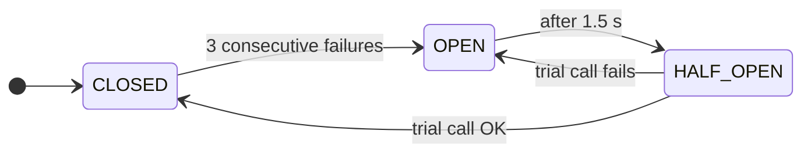

# 1. Circuit Breaker

**Solution.** `ms-requests` (hospital blood requests) depends on `ms-inventory`. Its call is protected by a
circuit breaker in two versions with the same settings (3 failures → OPEN, 1.5 s → HALF_OPEN, 1 trial call):

* **Own implementation** – [`CircuitBreaker.java`](../backend/ms-requests/src/main/java/ec/edu/uce/yawar/requests/resilience/CircuitBreaker.java): thread-safe state machine, fallback = last known stock.
* **Resilience4j** – [`Resilience4jAdapters.java`](../backend/ms-requests/src/main/java/ec/edu/uce/yawar/requests/r4j/Resilience4jAdapters.java) (programmatic) and
  [`StockService.java`](../backend/ms-requests/src/main/java/ec/edu/uce/yawar/requests/StockService.java) (annotations + `application.yml`, the production style for Yawar).

The demo endpoint `GET /api/requests/demo/circuit-breaker?impl=custom|resilience4j` makes 30 calls; during
calls 6–21 ms-inventory is switched to *hang* (2 s per request). It runs once **without** and once **with** the
breaker and returns the timeline.

**Run:** `./test.sh local` (docker compose) or `./test.sh aws` (through the ALB).
**Evidence:** `evidence/<target>/01-circuit-breaker.log`, the two JSON files and `circuit-breaker-latency.png`.
Expected: while the dependency hangs, callers wait ~8 s in total without the breaker and ~2.5 s with it, and
ms-inventory receives about half the requests. Unit tests: `CircuitBreakerTest` (5 tests).
