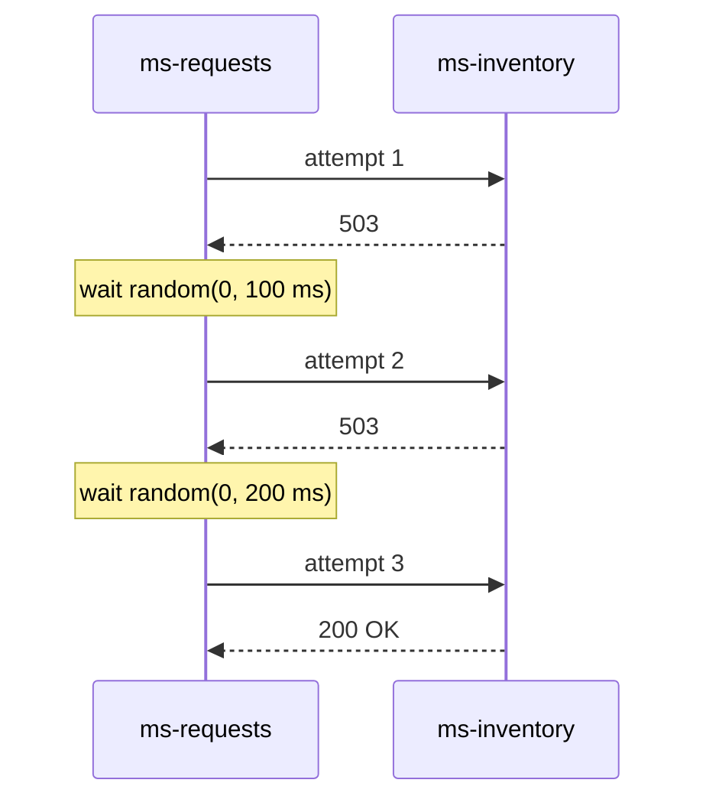

# 2. Retry

**Solution.** Exponential backoff with **full jitter**, a cap, max attempts, selective retry (only
`RetryableException` = 5xx/429/timeouts/I-O errors) and `Retry-After` support:

* **Own implementation** – [`Retry.java`](../backend/ms-requests/src/main/java/ec/edu/uce/yawar/requests/resilience/Retry.java)
* **Resilience4j** – `IntervalFunction.ofExponentialRandomBackoff` in
  [`Resilience4jAdapters.java`](../backend/ms-requests/src/main/java/ec/edu/uce/yawar/requests/r4j/Resilience4jAdapters.java) and `resilience4j.retry` in `application.yml`.
* **Idempotency** – `ms-inventory` stores `Idempotency-Key`s so a retried POST is not executed twice.

`GET /api/requests/demo/retry?impl=custom|resilience4j` runs: A) two 503s then success, B) a 400 that must not be
retried, C) a permanent outage (gives up), D) a POST whose response is lost — with and without idempotency key,
E) a 200-client simulation comparing peak load with and without jitter.

**Run:** `./test.sh local` or `./test.sh aws`. **Evidence:** `evidence/<target>/02-retry.log` + JSON.
Expected: 2 donations stored without key vs 1 with key; peak 200 vs ~70–85 requests per window. Unit tests: `RetryTest` (6).
