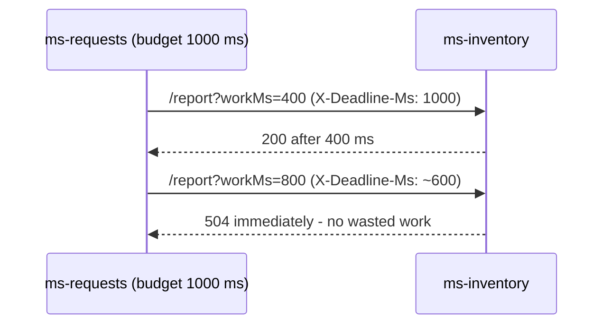

# 3. Timeout

**Solution.** Every remote call has an explicit bound:
* connect timeout on the client and per-request timeout ([`InventoryClient.java`](../backend/ms-requests/src/main/java/ec/edu/uce/yawar/requests/client/InventoryClient.java));
* a time limiter for any blocking call — own [`Timeouts.java`](../backend/ms-requests/src/main/java/ec/edu/uce/yawar/requests/resilience/Timeouts.java) and Resilience4j `TimeLimiter`;
* **deadline propagation**: a 1000 ms budget ([`Deadline.java`](../backend/ms-requests/src/main/java/ec/edu/uce/yawar/requests/resilience/Deadline.java)) whose remaining time travels in `X-Deadline-Ms`;
  `ms-inventory` refuses work it cannot finish in time (504 immediately).

**Run:** `./test.sh local` or `./test.sh aws`. **Evidence:** `evidence/<target>/03-timeout.log` + JSON.
Expected: 12 calls to a hanging service with 4 threads take ~6 s without timeout vs ~1.5 s with 0.5 s; the
deadline scenario ends in ~450 ms instead of ~1000 ms. Unit tests: `TimeoutTest` (3).
