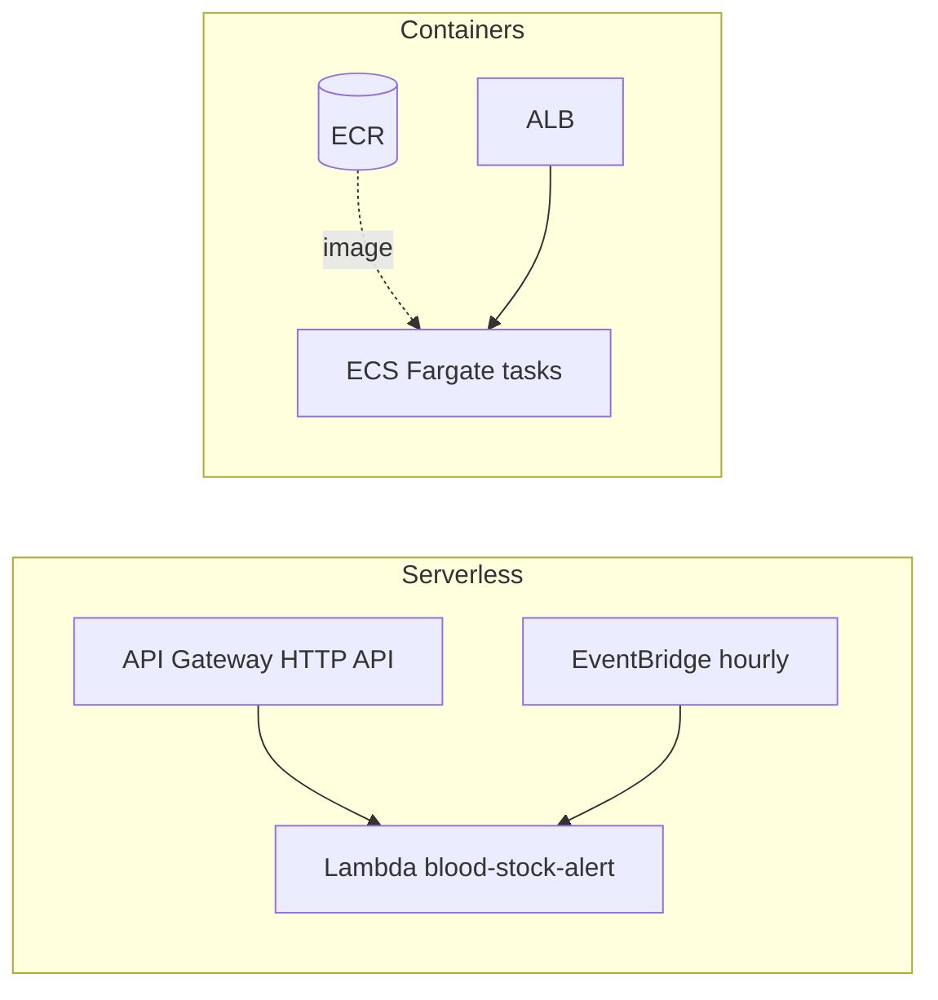

# 4. Serverless (AWS Lambda) and Docker containers (Amazon ECS)

The same Yawar domain in the two compute models.

| | `lambda/` | ECS (`infra/2-platform`) |
|---|---|---|
| Code | Python 3.14 `blood-stock-alert` | Java 21 + Spring Boot 4.1 `ms-donors`, `ms-inventory`, `ms-requests` |
| Trigger / entry | API Gateway HTTP API `POST /stock-alerts`, EventBridge `rate(1 hour)` | ALB path rules |
| Packaging | zip built by Terraform | Docker image (multi-stage, JRE 21) in Amazon ECR |
| Runtime | Lambda, 128 MB, 3 s timeout | Fargate tasks 0.5 vCPU / 1 GB, `LabRole` |
| Scaling | per request, to zero | desired count (3 donors, 1 inventory, 1 requests) |
| Self-healing | managed | ALB health check `/actuator/health` → ECS replaces unhealthy tasks |

**Run:**
* Lambda: `./lambda/deploy-and-test.sh` → `evidence/aws/04-lambda.log` (cold vs warm, `REPORT` lines, 400 on bad input). Local: `cd lambda && python3 -m pytest -q tests && python3 local_invoke.py events/*.json`.
* ECS: after `scripts/aws/03-platform.sh`, run `./ecs/test-aws.sh` → `evidence/aws/04-ecs.log` (services, tasks,
  task definition, a failure injected in one task, the ALB marking it unhealthy and ECS starting a replacement).
