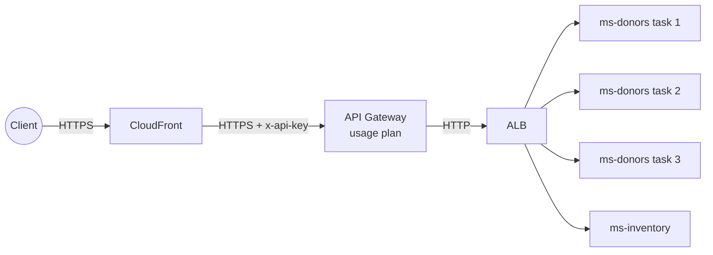

# 5. API Gateway, Load Balancer and Reverse Proxy

Each role is played by the AWS service built for it ([`terraform/main.tf`](terraform/main.tf)):

| Role | AWS service | What the test proves |
|---|---|---|
| Reverse proxy | **CloudFront** | HTTPS at the edge, origin hidden (`via`, `x-amz-cf-pop`), `/api/inventory` cached 5 s (`x-cache: Miss → Hit`) |
| API gateway | **API Gateway REST** | API key required (403 without it), usage plan throttling 1 req/s burst 5 (429), `/api/{proxy+}` routing |
| Load balancer | **ALB** (from `infra/2-platform`) | round robin over 3 `ms-donors` tasks (`X-Instance` changes), health checks |

**Run:** `./deploy-and-test.sh` (needs `scripts/aws/03-platform.sh` first) → `evidence/aws/05-edge.log`.
If the AWS account does not allow CloudFront, run `ENABLE_CLOUDFRONT=false ./deploy-and-test.sh`: the test then goes
straight to API Gateway (gateway + load balancer on AWS; the reverse-proxy role is explained with CloudFront's design).
AWS Academy denies the CloudFront cache-policy APIs, so the distribution uses the classic `forwarded_values` cache settings.
Note: the default integration timeout of a REST API is 29 s (regional APIs can raise it through a Service Quotas request), so the long resilience demos (topics 1–3) are called directly on the ALB.
