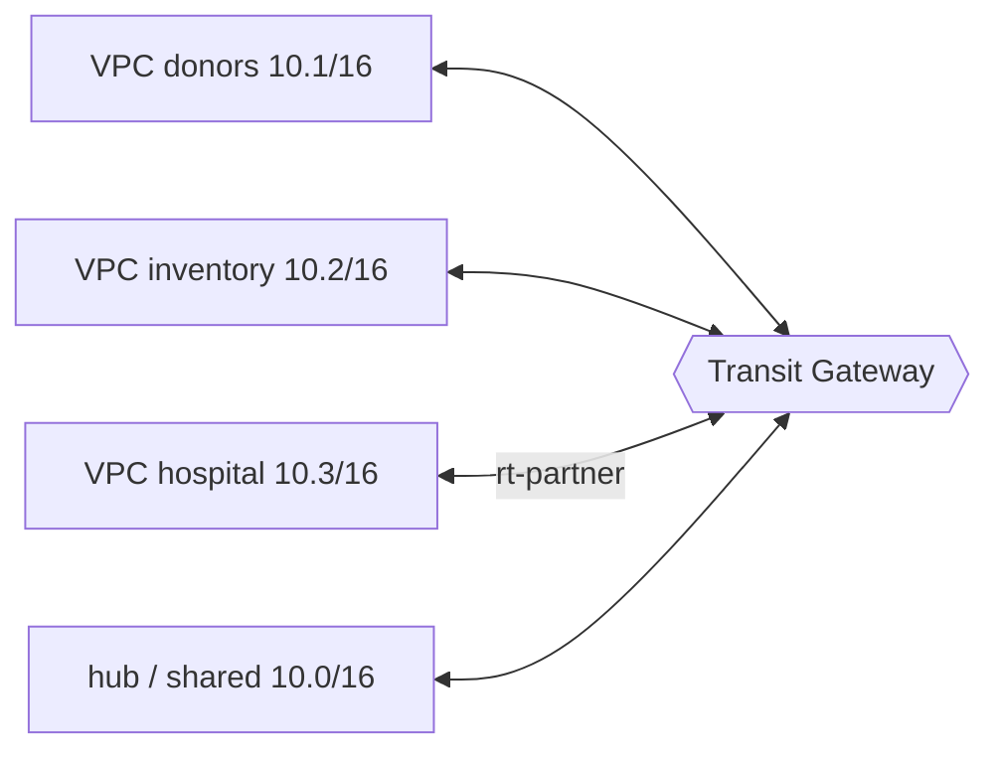

# 6. Hub-and-Spoke

Four VPCs attached to one **AWS Transit Gateway** (the hub). Two TGW route tables are the policy:

| Route table | Associated | Can reach |
|---|---|---|
| `rt-internal` | hub, donors, inventory | hub, donors, inventory, hospital |
| `rt-partner` | hospital (external partner) | hub, inventory — **never donors** |

A t3.nano probe in each VPC (`10.x.0.10`) serves HTTP and, at boot, tries the other three; results are printed
on its console and collected with `aws ec2 get-console-output`.

**Run:** `./deploy-and-test.sh` → `evidence/aws/06-hub-and-spoke.log`. Expected matrix: everything OK except
`hospital → donors` and `donors → hospital` (no return route) = FAIL. **Cost ≈ $0.22/h** — the script offers to destroy it at the end.
