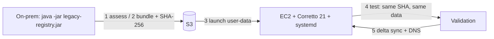

# 7. Lift-and-Shift (Rehost): on-premises → AWS

* **Source ("on-premises server")**: your machine runs `legacy-registry.jar` (plain Java 21, JDK HTTP server, data in a CSV file, config in `app.conf`).
* **Target**: an EC2 instance (Amazon Linux 2023 + Amazon Corretto 21) that runs the **same JAR** with the **same systemd unit**.

`migrate-to-aws.sh` executes the five phases:

1. **Assess** – app, port, data, JAR SHA-256.
2. **Replicate** – bundle (JAR + config + data + unit) with checksums → S3.
3. **Launch** – `terraform apply` (EC2 user-data installs Java and starts the service).
4. **Test** – SHA-256 of the running JAR on EC2 (`GET /about`) = on-prem; `GET /donors` identical.
5. **Cutover** – late write on-prem, freeze, final delta sync over SSH, new write on AWS, DNS switch.

**Run:** `KEY=~/.ssh/labsuser.pem ./migrate-to-aws.sh` (after `scripts/aws/01-bootstrap.sh`) → `evidence/aws/07-lift-and-shift.log`.
For whole servers (VMware, Hyper-V, physical) AWS uses Application Migration Service (MGN); here the app-level
rehost makes every phase visible.
