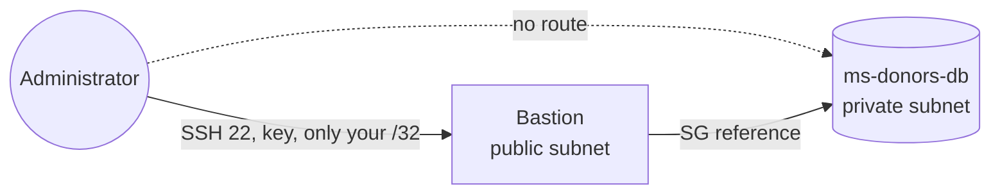

# 8. Bastion Host

VPC `10.30.0.0/16` with a **public subnet** (bastion, SSH only from your IP) and a **private subnet**
(`ms-donors-db`, no public IP, no internet route, SSH/8080 only from the bastion's security group).

**Run:** `KEY=~/.ssh/labsuser.pem ./deploy-and-test.sh` → `evidence/aws/08-bastion.log`. It shows:
1. the private instance has no public IP and is unreachable directly;
2. a command executed on it by jumping through the bastion (`ssh -J`);
3. port forwarding `localhost:9090 → private:8080`;
4. the bastion has no internet egress;
5. the sshd audit trail on the bastion.

[`ssh_config.example`](ssh_config.example) shows the `ProxyJump` configuration. Modern alternative: AWS Systems
Manager Session Manager (no inbound port 22 at all).
