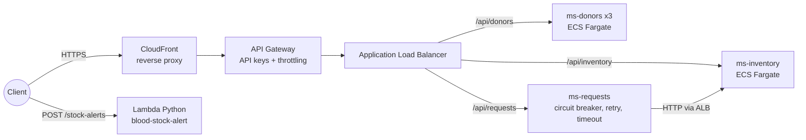

# Cloud Architecture & Design Patterns — applied to Yawar (Java + AWS)

Research assignment: eight cloud patterns/technologies, implemented around **Yawar**, a microservices
platform for blood-donation management in Ecuador, and deployed on **AWS** (AWS Academy Learner Lab).

| Layer | Technology |
|---|---|
| Backend | **Java 21 (LTS) + Spring Boot 4.1**: `ms-donors`, `ms-inventory`, `ms-requests`, `legacy-registry` (plain Java) |
| Resilience | Own implementation **and** Resilience4j 2.4 (`resilience4j-spring-boot4`) |
| Serverless | AWS Lambda in **Python 3.14** |
| Containers | Docker images in Amazon ECR, Amazon ECS on Fargate |
| Infrastructure | **Terraform** (one stack per topic), AWS CLI scripts that write the evidence |



| # | Topic | Where | AWS services |
|---|---|---|---|
| 1 | [Circuit Breaker](01-circuit-breaker) | `ms-requests` | ECS, ALB, CloudWatch Logs |
| 2 | [Retry](02-retry) | `ms-requests` + `ms-inventory` | ECS, ALB |
| 3 | [Timeout](03-timeout) | `ms-requests` | ECS, ALB |
| 4 | [Serverless & containers](04-serverless-and-containers) | Lambda (Python) + ECS (Java) | Lambda, API Gateway HTTP API, EventBridge, ECR, ECS Fargate |
| 5 | [API Gateway, Load Balancer, Reverse Proxy](05-api-gateway-lb-reverse-proxy) | edge stack | CloudFront, API Gateway REST, ALB |
| 6 | [Hub-and-Spoke](06-hub-and-spoke) | network stack | Transit Gateway, 4 VPCs, EC2 probes |
| 7 | [Lift-and-Shift](07-lift-and-shift) | `legacy-registry` | S3, EC2 (Amazon Corretto), systemd |
| 8 | [Bastion](08-bastion) | network stack | VPC public/private subnets, EC2, security groups |

## Versions (checked against the official release pages in November 2026)

| Component | Version used | Why |
|---|---|---|
| Java | 21 LTS (`eclipse-temurin:21`) | Supported LTS; Spring Boot 4.1 supports Java 17–26 |
| Spring Boot | 4.1.2 | Current GA line (3.5 OSS support ended on 30 June 2026); Boot 4 starters `webmvc`, `aspectj`, `webmvc-test` |
| Resilience4j | 2.4.0, module `resilience4j-spring-boot4` | First release with a Spring Boot 4 module |
| Maven | 3.x (`maven:3-eclipse-temurin-21`) | Maven 4 is still a release candidate |
| Terraform | ≥ 1.10, AWS provider `~> 6.0` | Provider 6 is the current major version |
| Lambda runtime | `python3.14` | Latest GA Python runtime |
| Amazon Linux | AL2023 via the public SSM parameter `/aws/service/ami-amazon-linux-latest/...` | Always the latest AMI, no hard-coded name |
| Docker Compose | Compose Specification (top-level `name:`, no `version:` key) | `version` is obsolete |

## Requirements
Windows users: run everything inside **WSL2 (Ubuntu)** with Docker Desktop's WSL integration enabled.

* Java 21+ and Maven 3.9+, Docker (Compose v2: `docker compose`), Python 3 (`pip install pytest matplotlib`), Terraform ≥ 1.5, AWS CLI v2, `curl`, `ssh`.
* AWS Academy: start the Learner Lab, copy **AWS Details → AWS CLI** into `~/.aws/credentials`,
  download `labsuser.pem` to `~/.ssh/labsuser.pem`. Region `us-east-1`.

## 1) Test locally first (free)
```bash
./scripts/local/test-local.sh      # mvn test + docker compose + demos 1-3  -> evidence/local/
```

## 2) Deploy and test on AWS (run in this order)

| Step | Command | Time | Cost while running |
|---|---|---|---|
| Check tools/credentials | `./scripts/aws/00-check.sh` | 1 min | – |
| ECR + S3 | `./scripts/aws/01-bootstrap.sh` | 1 min | ~0 |
| Tests + build + push images | `./scripts/aws/02-build-push.sh` | 5–8 min | ~0 |
| VPC + ALB + ECS (5 tasks) | `./scripts/aws/03-platform.sh` | 6–10 min | ~$0.18/h |
| Topics 1–3 | `./01-circuit-breaker/test.sh aws` · `./02-retry/test.sh aws` · `./03-timeout/test.sh aws` | 3 min | – |
| Topic 4 – ECS self-healing | `./04-serverless-and-containers/ecs/test-aws.sh` | 5 min | – |
| Topic 4 – Lambda | `./04-serverless-and-containers/lambda/deploy-and-test.sh` | 2 min | ~0 |
| Topic 5 – edge | `./05-api-gateway-lb-reverse-proxy/deploy-and-test.sh` | 10–15 min | ~0 at demo traffic |
| Topic 6 – Transit Gateway | `./06-hub-and-spoke/deploy-and-test.sh` (offers to destroy at the end) | 10 min | ~$0.22/h |
| Topic 7 – migration | `KEY=~/.ssh/labsuser.pem ./07-lift-and-shift/migrate-to-aws.sh` | 10 min | ~$0.03/h |
| Topic 8 – bastion | `KEY=~/.ssh/labsuser.pem ./08-bastion/deploy-and-test.sh` | 5 min | ~$0.02/h |
| **Delete everything** | `./scripts/aws/destroy-all.sh` | 10–15 min | – |

Every script writes its output to `evidence/aws/<step>.log` (plus JSON and a chart for topic 1).
A full session (deploy → evidence → destroy) takes about 1.5–2 h and costs roughly **$1–2** of credit.
Costs are approximate us-east-1 on-demand prices; always run `destroy-all.sh` at the end.

## Repository layout
```
backend/                 Java (Maven multi-module) + Dockerfile + docker-compose.yml
infra/1-bootstrap        Terraform: ECR repositories, S3 artefact bucket
infra/2-platform         Terraform: VPC, ALB, ECS cluster, 3 Fargate services
0X-<topic>/              README, Terraform (if any), deploy/test script for that topic
scripts/aws, scripts/local
evidence/aws, evidence/local   generated by YOUR runs
docs/                    research report (report.html), diagrams
```

## Honesty notes
* The Java code was written in an environment without access to Maven Central: the dependency-free
  parts (custom circuit breaker, retry, timeout, HTTP client, demo scenarios, legacy app) were compiled
  and executed there; the Spring Boot / Resilience4j parts are compiled for the first time by `mvn test`
  on your machine.
* Terraform was syntax-checked only; the first `terraform apply` happens in your AWS account.
